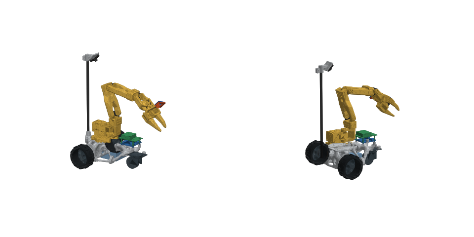
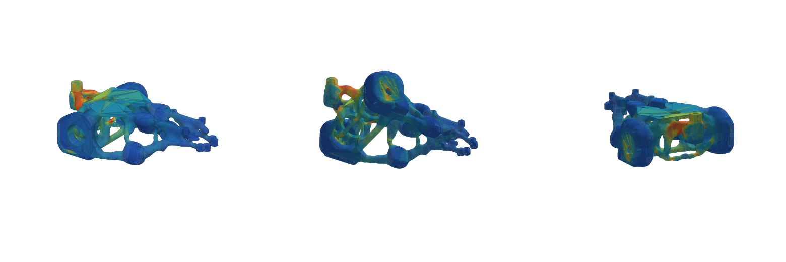

# SO-101 Bone Rover

A 3D-printable mobile base for the [SO-101](https://github.com/TheRobotStudio/SO-ARM100) robot arm, generated with
3D topology optimization and checked with FEA. Two JGB37-520 encoder gearmotors drive 100 mm wheels at the back,
one 2" swivel caster carries the nose. Every strut grew where a load runs from the arm to the wheels.



- **Printer:** Bambu Lab A1 mini (180 × 180 × 180 mm). The frame prints as 4 pieces joined by rounded, bolted knuckles.
- **Drive:** 2 × JGB37-520 12 V with Hall encoder (1:90), 100 mm wheels, about 0.58 m/s.
- **Electronics:** Waveshare General Driver for Robots (ESP32) on the front deck; optional Raspberry Pi 5 stacked on it; 3S pack under the arm.
- **Cameras:** a 32 × 32 mm USB camera on the official SO-101 wrist mount, plus a wide-angle one on a 380 mm mast at the tail. No depth camera needed for LeRobot-style policies.

## Print it

Everything you need is in [`print_package/`](print_package/): 6 STLs already rotated for printing, plus a
[README](print_package/README.md) with slicer settings, the screw and insert list, parts to buy and assembly steps.

Check these against your parts first (they vary by seller), then regenerate if needed: motor gearbox length and
face-hole angle, wheel size, caster height. All are single numbers in [`params.py`](params.py).

## Results (Print-friendly variant)

| | |
|---|---|
| Frame | ~441 g PLA/PETG (55% fill estimate), 4 pieces, all fit the A1 mini |
| Worst safety factor | 40× (camera mast knocked sideways, 3 g); all other cases 89–137× |
| Gripper error from frame flex | 0.15 mm at full reach |



## How it is made

| Step | Script | What it does |
|---|---|---|
| 1 | `topo.py` | 3D SIMP topology optimization (hex8, 6 mm grid, 13 load cases, 45° overhang filter, y-mirror). ~45–75 min. |
| 2 | `parts.py`, `arm_export.py` | Reference models (motor with encoder, wheels, caster, driver, mast) and the official SO-101 + wrist camera, posed via its URDF. |
| 3 | `structure.py` | Density → smooth isosurface, exact mounting features, bolted knuckle joints grown into the bone, split into 4 printable pieces. |
| 4 | `export_web.py` | Compact meshes for the 3D viewer. |
| 5 | `verify.py` | FEA of the finished frame (PETG, 2.5 mm voxels): safety factors, deflection, stress map. |
| 6 | `structure.py` with `REFINE=1` | Uses the stress map: removes dead fins and tails, thickens thin load-carrying bridges to 5 mm. Then steps 4–5 again. |
| 7 | `make_page.py`, `package.py` | Builds `index.html` (3D viewer) and the print package. |

```bash
uv venv .venv --python 3.12 && uv pip install --python .venv/bin/python -r requirements.txt
.venv/bin/python topo.py 0.13 50 topo_print.npz am      # optional: topo_print.npz is included
.venv/bin/python parts.py && .venv/bin/python arm_export.py
.venv/bin/python structure.py topo_print.npz print && .venv/bin/python export_web.py && .venv/bin/python verify.py print
REFINE=1 .venv/bin/python structure.py topo_print.npz print && .venv/bin/python export_web.py && .venv/bin/python verify.py print
.venv/bin/python make_page.py && .venv/bin/python package.py print
python3 -m http.server 8765   # then open http://localhost:8765/index.html
```

`docs/design_history/` shows how the design got here: from a flat 2D panel, through servo and ball-caster versions,
to the rear-drive frame. `history/` keeps the early 2D and servo-drive scripts.

## Credits

The SO-101 arm model, URDF and the wrist camera mount in [`vendor/`](vendor/) are from
[TheRobotStudio/SO-ARM100](https://github.com/TheRobotStudio/SO-ARM100), Apache-2.0 (license in `vendor/so101/LICENSE`).
